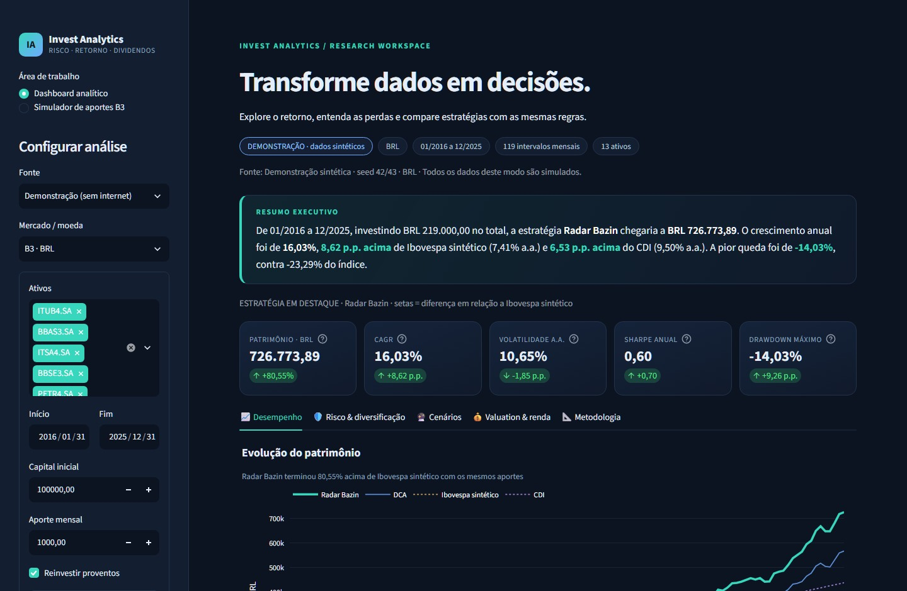
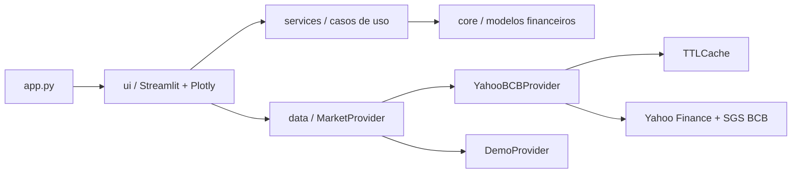

# Invest Analytics — risco visível, decisões fundamentadas

[](https://github.com/Allyshow-unicamp/invest-analytics-dashboard/actions/workflows/ci.yml)


**Um workspace de pesquisa de investimentos que transforma cotações e dividendos em comparações auditáveis de risco e retorno.**

O projeto nasceu de um motor Python que calculava alocações e publicava resultados em planilhas. A evolução concentra a análise em uma aplicação Streamlit: premissas editáveis, gráficos interativos, regras financeiras isoladas e validação automatizada.



## O problema de negócio

Um saldo maior pode refletir novos aportes, sem indicar uma estratégia melhor. Um dividend yield elevado também não responde quanto risco o investidor assumiu. Decisões de alocação exigem comparar o retorno com os fluxos, as perdas e as premissas que o produziram.

O Invest Analytics permite investigar essas perguntas em uma única interface:

- **Desempenho:** patrimônio e retorno acumulado livre de aportes, com comparação entre Radar Bazin, DCA, índice e caixa.
- **Risco:** CAGR, volatilidade anualizada, Sharpe, drawdown máximo, VaR e CVaR históricos de 95% por mês.
- **Diversificação:** correlação dos retornos totais e nuvem de carteiras simuladas sem alavancagem.
- **Cenários:** bootstrap histórico com capital atual, aportes futuros e bandas de percentis.
- **Dividendos:** Radar Bazin com cinco anos completos de histórico e calculadoras de valuation por yield, Gordon e renda em USD.
- **Mercados separados:** ativos brasileiros em BRL e americanos em USD, com benchmarks e referências próprios.
- **Aportes B3:** carteira editável de ações, FIIs e ETFs, compras sem vendas, lotes inteiros, caixa residual e impacto na volatilidade.

## Execute localmente

**Requisito:** Python 3.14 de 64 bits. Dependências diretas fixadas em `requirements.txt`; ferramentas de desenvolvimento em `requirements-dev.txt`.

Windows / PowerShell, na pasta do projeto:

```powershell
python -m venv .venv
.\.venv\Scripts\Activate.ps1
python -m pip install -r requirements.txt
streamlit run app.py
```

Se a política local não permitir ativar scripts, use o interpretador do ambiente diretamente:

```powershell
.\.venv\Scripts\python.exe -m pip install -r requirements.txt
.\.venv\Scripts\python.exe -m streamlit run app.py
```

Linux / macOS:

```bash
python3.14 -m venv .venv
source .venv/bin/activate
python -m pip install -r requirements.txt
streamlit run app.py
```

Abra [localhost:8501](http://localhost:8501). A aplicação inicia em **Demonstração**, com dados sintéticos reproduzíveis de 2010 a 2025. O uso cotidiano da demonstração não depende de internet, credenciais, CSVs ou planilhas; a instalação inicial de pacotes exige acesso ao registro Python.

Para dados reais, selecione **Mercado (Yahoo + BCB)** na barra lateral, escolha ativos e período e clique em **Analisar carteira**. Somente meses encerrados são usados. A data inicial indica o mês da posição inicial; os retornos começam no intervalo seguinte. O botão **Atualizar dados de mercado** invalida o cache em memória.

## Uma demonstração para avaliação técnica

1. Abra o modo offline e compare Radar Bazin, DCA e caixa com os mesmos aportes.
2. Alterne entre patrimônio e retorno acumulado: os gráficos mostram a diferença entre dinheiro aportado e rentabilidade.
3. Inspecione drawdown, distribuição de perdas e correlação para contextualizar o retorno.
4. Altere o horizonte de cenários e observe a dispersão dos resultados possíveis.
5. Consulte **Metodologia** para revisar as hipóteses antes de interpretar os indicadores.

Os resultados da demonstração são cenários sintéticos, sem relação com a performance histórica dos tickers exibidos.

## Simulador de aportes B3

Acesse **Simulador de aportes B3** em **Área de trabalho**, na barra lateral. O dashboard analítico continua disponível na mesma navegação.

O módulo resolve uma decisão recorrente: **onde aplicar o próximo aporte sem vender posições existentes?** Usar o aporte para corrigir desvios pode aproximar a carteira da política de alocação e evitar vendas desnecessárias. A otimização permite investigar alternativas de risco, respeitando a posição que o investidor já possui.

### Como usar

1. Edite os tickers, classes, quantidades atuais, preços médios e metas. A soma das metas por ativo deve ser **100%**. As classes são informativas; metas por classe podem ser expressas distribuindo seu percentual entre os ativos daquela classe.
2. Informe o aporte em reais e o lote mínimo de cada ativo. **Lote 1** permite compras unitárias; lote 100 exige múltiplos de 100. No mercado fracionário são negociadas quantidades inteiras, não partes decimais de uma ação/cota.
3. Escolha rebalanceamento inteligente, alocação proporcional ou otimização de risco/retorno. A otimização oferece variância mínima e Sharpe máximo.
4. Selecione demonstração ou Yahoo Finance e clique em **Simular aporte**. Consultas e cálculos ocorrem somente ao enviar o formulário.
5. Confira ordens indicativas, caixa residual, pesos antes/depois versus metas e volatilidade da carteira consolidada.

O preço médio acompanha o custo da posição e é atualizado após a compra. **A alocação usa a cotação de mercado**, sem confundir custo histórico com exposição atual. A tabela aceita códigos como `ITUB4`, `HGLG11`, `BOVA11` e `ITUB4.SA`; o sufixo `.SA` é normalizado automaticamente. Um código fracionário como `ITUB4F` consulta o preço-base `ITUB4.SA`. A cotação desse livro pode diferir da referência consultada.

### Estratégias e restrições

Considere `v_i = quantidade_i × preço_i`, patrimônio atual `V = soma(v_i)`, aporte `A`, meta `t_i` e compra financeira `x_i`.

| Modo | Cálculo adotado |
| --- | --- |
| Rebalanceamento inteligente | Minimiza `soma(((v_i + x_i)/(V+A) - t_i)²)`, com `x_i >= 0` e `soma(x_i)=A`. Projeta os déficits `d_i=t_i(V+A)-v_i` no simplex: `x_i=max(d_i-τ,0)`, escolhendo `τ` para que as compras somem o aporte. |
| Proporcional direta | Define `x_i=A×t_i`, sem corrigir o desvio já existente nas posições. |
| Variância mínima | Usa SLSQP para minimizar `w_finalᵀ Σ_anual w_final`, onde `w_final=(v+A×z)/(V+A)`, `z>=0` e `soma(z)=1`. A carteira atual é mantida; somente o dinheiro novo é otimizado. |
| Sharpe máximo | Usa a mesma região viável e maximiza o excesso esperado dividido pela volatilidade. O retorno esperado vem da média dos retornos diários ajustados; a taxa anual efetiva informada é convertida para taxa diária antes da anualização. |

**Meta zero bloqueia novas compras em todos os modos**, preservando posições antigas. Nos modos de risco, metas positivas definem quais ativos podem receber dinheiro; os percentuais alvo não são restrições rígidas de exposição. Assim, uma carteira otimizada pode permanecer distante das metas. O Sharpe utiliza múltiplos pontos iniciais determinísticos, mas a solução numérica não tem garantia de máximo global.

O otimizador emprega o [SLSQP do SciPy](https://docs.scipy.org/doc/scipy/reference/optimize.minimize-slsqp.html), com validação de convergência, orçamento e não negatividade. Não se trata de execução automática de ordens.

### Quantidades inteiras e caixa residual

O plano contínuo é arredondado para baixo em múltiplos do lote mínimo. Uma busca gulosa tenta usar a sobra em um lote adicional por ativo quando isso reduz o erro quadrático em relação ao plano contínuo. A alocação discreta é **heurística**: não promete o melhor plano inteiro e pode preservar caixa mesmo quando alguma compra ainda cabe no orçamento.

Preços e aporte são contabilizados em **centavos**, com arredondamento comercial. O motor verifica:

```text
total em compras + caixa residual = aporte
quantidade a comprar >= 0
quantidade a comprar é múltipla do lote mínimo
peso final do ativo = valor após compra / (patrimônio atual + aporte)
```

O caixa residual permanece no total da carteira. Os pesos dos ativos somados ao peso desse caixa resultam em 100%. Carteira já balanceada recebe dinheiro na proporção das metas, sujeito aos lotes. Se o aporte não comporta nenhuma compra válida, fica integralmente em caixa.

### Cotações e impacto no risco

- O modo real consulta o histórico intradiário de 1 minuto no Yahoo, com referência de horário em São Paulo. Sem série intradiária, usa o último fechamento diário e identifica esse fallback. Cotações ausentes, não positivas ou com mais de sete dias são recusadas.
- **Última cotação disponível não é garantia de tempo real.** O provedor pode ter atraso; o preço de execução pode mudar. O cache de cotações dura 60 segundos e pode ser ignorado na simulação; o histórico diário é armazenado por uma hora. Nenhuma falha é armazenada como resultado válido.
- A matriz de covariância usa retornos diários de preços ajustados, janela comum de 1, 3 ou 5 anos e exclusão do pregão corrente. Não se preenchem lacunas com preços de outro dia.
- A volatilidade anual é `sqrt(wᵀ Σ_diária w × 252)`, usando a mesma amostra antes/depois. São exigidos ao menos 60 retornos completos por ativo para risco e otimização.
- São mostrados o risco após o aporte **com o caixa residual** e o risco **somente dos ativos investidos**. O caixa é tratado como volatilidade zero; uma queda do risco consolidado pode decorrer de dinheiro não aplicado.
- Histórico insuficiente não bloqueia o rebalanceamento ou o proporcional quando há cotações válidas. O impacto no risco fica indisponível; as estratégias de otimização exigem histórico suficiente.
- A carteira e os resultados ficam na memória da sessão no servidor. O provedor recebe tickers e datas, sem quantidades ou preços médios. Nada é gravado em arquivos nem enviado a corretoras.

Custos, impostos, liquidez, spreads e slippage não entram no plano. Retorno esperado e risco histórico são estimativas retrospectivas. O exemplo inicial de ação/FII/ETF tem dados fictícios no modo demonstração e não representa uma indicação de ativos.

## Arquitetura e manutenção

```text
invest-analytics-dashboard/
├── app.py                       # Entry point
├── core/
│   ├── metrics.py               # Retorno, risco e caudas históricas
│   ├── portfolio.py             # Posições, fluxos, carteiras e bootstrap
│   ├── allocation.py            # RebalancingEngine e alocação discreta B3
│   ├── bazin.py                 # Sinais e alocação de novos recursos
│   └── valuation.py             # DYT, Gordon e renda parametrizada
├── data/
│   ├── models.py                # MarketData e contrato MarketProvider
│   ├── fetcher.py               # Adaptador Yahoo/BCB e limpeza
│   ├── b3_market.py             # Cotações recentes e histórico diário B3
│   ├── cache.py                 # Cache TTL genérico e limitado
│   └── demo.py                  # Fonte sintética determinística
├── services/
│   ├── analytics.py             # Caso de uso da comparação
│   ├── allocation.py            # Caso de uso de novos aportes
│   └── logging_config.py        # Logs JSON
├── ui/
│   ├── dashboard.py             # Composição e entradas Streamlit
│   ├── components.py            # Cards, tabelas e metodologia
│   ├── charts.py                # Figuras Plotly
│   ├── allocation_charts.py     # Pesos antes/depois e destino do aporte
│   └── views/rebalance_view.py  # Formulário e resultados do aporte B3
├── tests/                       # Testes unitários, contratos e AppTest
├── docs/                        # Migração, publicação e captura da UI
├── .github/workflows/ci.yml     # Lint, formatação, tipos e testes
├── .streamlit/config.toml       # Tema e preferências da aplicação
├── requirements.txt
├── requirements-dev.txt
└── pyproject.toml
```



| Decisão | Benefício e limite prático |
| --- | --- |
| Domínio sem Streamlit, rede ou arquivos | Fórmulas e simulação podem ser testadas e usadas em um serviço HTTP ou processamento em lote. |
| `MarketProvider` como `Protocol` | Substitui a fonte por um provedor licenciado sem modificar o motor de carteiras. |
| Serviço de análise separado | Centraliza janelas, moedas, fluxos e referências da comparação. |
| Cache TTL de uma hora, máximo de 16 entradas | Evita downloads repetidos, copia objetos para isolar mutações e não armazena falhas. É local ao processo; múltiplas réplicas pedem cache distribuído. |
| Retornos e matrizes com NumPy/pandas | Simulação de alocações vetorizada; posições mensais mantêm um loop explícito para auditoria dos fluxos. |
| Nuvem amostral e otimização com propósitos distintos | O dashboard explora carteiras simuladas; o simulador de aportes usa SciPy/SLSQP, respeitando as posições existentes e sem alegar ótimo inteiro. |
| Logs JSON e erros de domínio | Facilita diagnóstico de indisponibilidade e qualidade de dados sem depender da interface. |
| Dados sintéticos determinísticos | Demonstrações e testes funcionam sem rate limits ou respostas mutáveis de APIs. |

A separação aplica responsabilidade única e inversão de dependência na fronteira de ingestão, sem criar camadas de abstração para cada fórmula. Detalhes da transição estão em [docs/MIGRATION.md](docs/MIGRATION.md).

## Convenções financeiras

Todas as taxas internas são frações: `0.01` representa 1%. A frequência do dashboard é mensal.

| Indicador | Definição adotada |
| --- | --- |
| Retorno por intervalo | `V_antes_do_aporte / V_anterior - 1`; a primeira linha representa a posição inicial. |
| Retorno acumulado | `produto(1 + r) - 1`. |
| CAGR | `produto(1 + r) ** (12 / n) - 1`. |
| Volatilidade anual | `std(r, ddof=1) * sqrt(12)`. |
| Sharpe anual | `mean(r - rf_mensal) / std(r - rf_mensal, ddof=1) * sqrt(12)`. |
| Drawdown | Cota acumulada dividida pelo pico, incluindo a cota inicial 1, menos 1. |
| VaR 95% mensal | `max(0, -quantile(r, 0.05))`, com interpolação linear. |
| CVaR 95% mensal | Perda média das observações iguais ou inferiores ao quantil; limitada inferiormente a zero. |
| DPA ponderado | Soma dos DPAs dos cinco anos anteriores com pesos 1, 2, 3, 4 e 5, dividida por 15. |

O Sharpe segue a definição baseada em retornos diferenciais discutida por [William F. Sharpe](https://stanford.edu/~wfsharpe/art/sr/sr.htm). A anualização por raiz do tempo é uma convenção que pode ser inadequada sob autocorrelação. Métricas sem base estatística suficiente aparecem como `—`.

**Fluxos comparáveis.** O capital entra no fechamento inicial; cada intervalo seguinte recebe um aporte de fim de mês. Retornos são calculados antes desse aporte. Dividendos são creditados sobre posições anteriores. O fluxo inicial não recebe um aporte mensal extra. Sem capital inicial, períodos sem base de patrimônio ficam sem retorno mensurável.

**Dados e proventos.** `auto_adjust=False` é explícito no download. O backtest usa `Close` e dividendos separados; correlação e alocações usam `Adj Close`, sem somar proventos novamente. O adaptador assume a base de desdobramentos fornecida pelo Yahoo; não multiplica posições por splits novamente. A [documentação do yfinance](https://ranaroussi.github.io/yfinance/reference/api/yfinance.download.html) descreve os parâmetros e a data final exclusiva, convertida pelo adaptador a partir da data inclusiva da interface.

**Referências.** O CDI diário SGS 12 é composto por mês. Falta de CDI não vira retorno zero. O [Ibovespa é um índice de retorno total em reais](https://www.b3.com.br/pt_br/market-data-e-indices/indices/indices-amplos/ibovespa.htm); seus dividendos não são adicionados novamente. Nos EUA, o benchmark é SPY ajustado e o Sharpe usa uma taxa anual efetiva USD informada pelo usuário; caixa USD rende 0% neste modelo.

## Qualidade dos dados e limites

- Datas são ordenadas, duplicatas da resposta diária são consolidadas e meses incompletos são excluídos.
- A janela de preços usa a interseção dos históricos dos ativos e benchmark. O recorte é informado. Lacunas mensais internas, preços não positivos e valores não finitos bloqueiam o estudo.
- Nenhum preço é preenchido com dados futuros. Meses com variação acima de 50% são sinalizados e preservados, pois remover crises distorceria o risco.
- O Radar exige cinco anos completos por ativo. Ano sem proventos é zero; mês sem informação impede o sinal. O histórico de aquecimento é preservado fora da janela de simulação.
- Falha de dados reais gera uma mensagem de erro e permite nova tentativa. O modo sintético é uma escolha explícita, sem substituição automática da fonte.
- Dividendos são aproximados pela data ex e agregados mensalmente. Reinvestimento e sinais de fechamento simplificam a execução real. O Radar não liquida posições por ficarem caras.
- Custos, tributação, slippage, lotes, falências e alterações históricas do universo não são modelados. A cesta atual carrega viés de sobrevivência.
- O bootstrap assume meses independentes. As bandas não são previsão nem probabilidade calibrada de desempenho futuro.
- Yahoo/BCB podem limitar consultas ou corrigir históricos. O software não oferece SLA de dados de mercado. Revise os termos das fontes antes de qualquer redistribuição comercial.

## Testes e integração contínua

```powershell
python -m pip install -r requirements-dev.txt
python -m ruff check .
python -m ruff format --check .
python -m mypy
python -m pytest
```

A suíte cobre perdas iniciais, fluxos iguais entre estratégias, base zero de patrimônio, reinvestimento, aquecimento do Radar, ausência de lookahead no DPA, percentuais do CDI, formatos do Yahoo, lacunas, TTL e isolamento do cache. Os testes Streamlit verificam a interface, a troca de mercado, carteira vazia, valores zerados e falhas da fonte. Não fazem requisições externas.

Os testes do novo módulo cobrem aporte insuficiente, carteira balanceada, metas zeradas, lotes, orçamento em centavos, preço médio separado do valor de mercado, ausência de vendas, carteira consolidada na otimização, volatilidade com caixa e amostras insuficientes. Casos de dois ativos com covariância conhecida verificam os resultados matemáticos; testes com orçamentos aleatórios verificam as invariantes do plano. AppTest cobre formulário, navegação e os dois critérios de risco.

O workflow **Quality checks** executa as mesmas verificações no GitHub Actions com Python 3.14. Os pins são de dependências diretas; dependências transitivas seguem os intervalos dos fornecedores. Para uma implantação com reprodutibilidade binária, gere um lock completo no ambiente de destino.

## Publicação no GitHub

A sequência completa em PowerShell, com Conventional Commits e `gh repo create --public`, está em **[docs/PUBLISH.md](docs/PUBLISH.md)**.

O código novo não precisa de Google Sheets nem de chave de serviço. O `.gitignore` exclui credenciais, caches, ambientes e o legado local. Os arquivos antigos foram mantidos como referência, fora da distribuição pública. Os CSVs antigos não são consumidos: não existe metadado confiável indicando se seus preços já incorporam proventos, e somá-los novamente poderia duplicar o retorno.

Esta ferramenta apoia pesquisa e avaliação de hipóteses de investimento. Nenhum resultado constitui garantia de retorno ou recomendação individual.
